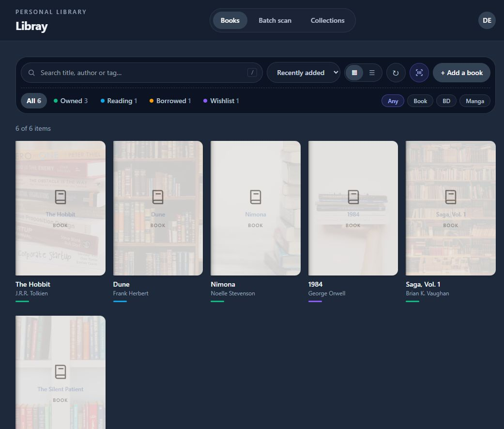
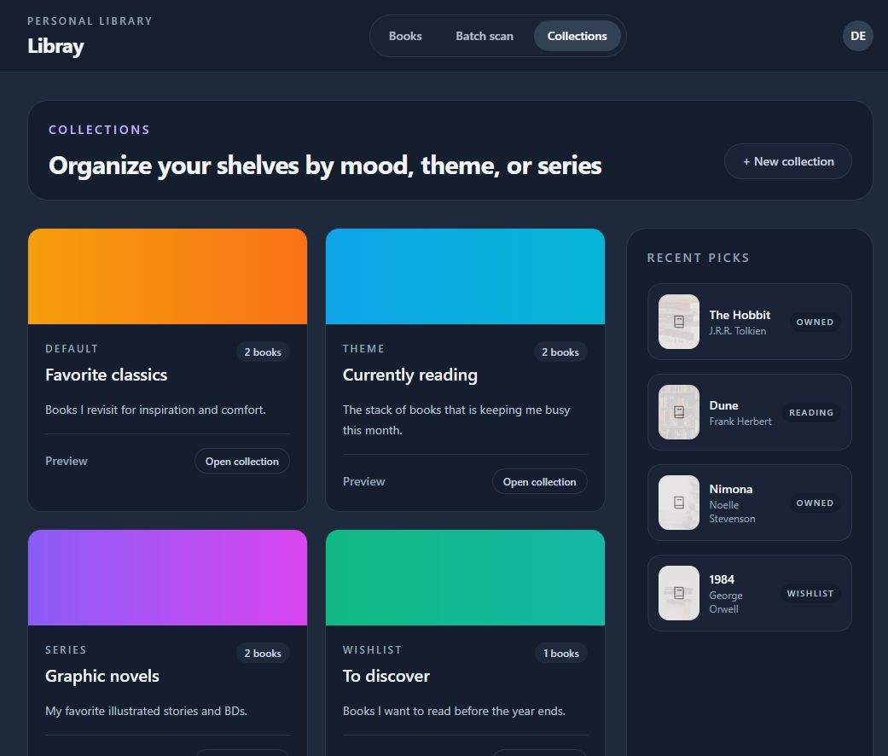
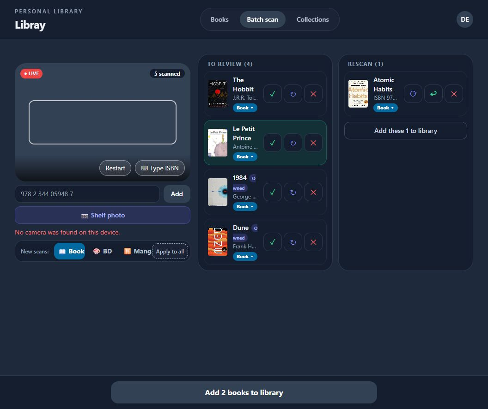

# Libray

A personal library manager for books, BD (comics) and manga. Track what you own, are reading, have lent out or want to buy, organise items into collections, and add whole shelves quickly by scanning barcodes or photographing a shelf.

## Screenshots

| Library | Collections |
| --- | --- |
|  |  |

| Batch scan |
| --- |
|  |

> Captured with demo data. The camera area shows "No camera" because the capture machine had no webcam; the books were added with the ISBN field.

## Features

- **Library**: cover grid or list view, full-text search (title, author, tag, press `/` to focus), sorting, and filters by status (owned, reading, borrowed, wishlist) and kind (Book, BD, Manga). Detail modal with metadata refresh and cover lookup.
- **Collections**: group items by theme, series, author or wishlist.
- **Batch scan**: scan ISBN barcodes with the camera (`barcode-detector` / `zxing-wasm`), type an ISBN, or upload a **shelf photo**: spines are read in the browser with Tesseract.js and matched to ISBNs through Open Library. Scanned items land in a review list before being added.
- **Accounts**: email/password sign-in, password reset, email change, avatar, language and account deletion.
- **Admin tools**: scan failure log for diagnosing bad scans.
- **i18n**: English, French and German.
- **Dark theme** UI.

## Technology Stack

- **Frontend**: React 18, TypeScript, Vite, Tailwind CSS, TanStack Query, React Router, Radix UI
- **Auth and data**: [Supabase](https://supabase.com) (email/password auth, Postgres with owner-only Row Level Security, storage for avatars). The frontend talks to Supabase directly through a small `fetch` client (`frontend/src/services/supabase.ts`).
- **Tests**: Vitest and Testing Library
- **Deployment**: GitHub Pages via GitHub Actions
- **Legacy**: an Express + Drizzle backend and Docker Compose setup remain in the repo but are no longer used by the frontend (the backend still provides the `db:setup` script).
- **Package management**: npm workspaces

More detail in [docs/technology-decisions.md](docs/technology-decisions.md).

## Project Structure

```
libray-app/
├── frontend/
│   └── src/
│       ├── pages/        # Books, Collections, Batch scan, Account, Login, Admin scan logs
│       ├── components/   # Book cards/rows, detail modal, barcode scanner, profile menu...
│       ├── services/     # Supabase client, library API, ISBN, covers, book lookup, shelf reader
│       ├── auth/         # Auth context, language sync
│       ├── i18n/         # en / fr / de dictionaries
│       └── data/         # Mock data
├── supabase/schema.sql   # Tables, Row Level Security, avatar storage policies
├── backend/              # Legacy Express API + db:setup script that applies supabase/schema.sql
├── shared/               # Shared types
├── docs/                 # Documentation and screenshots
├── mockups/              # Static HTML design mockups
└── .github/workflows/    # deploy-pages.yml (frontend), db.yml (schema)
```

## Prerequisites

- Node.js 20+
- npm 10+
- A Supabase project (free tier is enough)

## Quick Start

1. **Install dependencies**
   ```bash
   npm install --workspaces
   ```

2. **Configure Supabase**: copy the root template and fill it in.
   ```bash
   cp .env.example .env
   ```
   | Variable | Used by | Purpose |
   | --- | --- | --- |
   | `SUPABASE_URL` | frontend | Project URL |
   | `SUPABASE_PUBLISHABLE_KEY` | frontend | Publishable (anon) key |
   | `SUPABASE_DB_PASSWORD` | `db:setup` only | Database password, never exposed to the browser |
   | `SUPABASE_DB_HOST`, `SUPABASE_DB_PORT`, `SUPABASE_DB_USER` | `db:setup` (optional) | Pooler connection (`postgres.<project-ref>`) |

3. **Create the tables**
   ```bash
   npm run db:setup -w backend
   ```
   This applies `supabase/schema.sql` (safe to run repeatedly).

4. **Create your account** in the Supabase dashboard (Authentication > Users > Add user). The app only offers sign-in, no sign-up.

5. **Add redirect URLs** for password-reset and email-change links in Supabase (Authentication > URL Configuration), for example `http://localhost:5173/` and your GitHub Pages URL.

6. **Run the app**
   ```bash
   npm run dev -w frontend
   ```
   Open http://localhost:5173.

See [docs/environment.md](docs/environment.md) for details.

## Scripts

```bash
# Frontend
npm run dev -w frontend       # Vite dev server
npm run build -w frontend     # Type-check and production build
npm run preview -w frontend   # Preview the production build
npm run test -w frontend      # Vitest
npm run lint -w frontend      # ESLint

# Database
npm run db:setup -w backend   # Apply supabase/schema.sql to your Supabase project

# Root (all workspaces)
npm run build
npm run test
npm run lint
```

## Data Model

All tables belong to the signed-in user and are protected by Row Level Security (see `supabase/schema.sql`).

- **books**: `id`, `kind` (Book / BD / Manga), `isbn`, `title`, `author`, `year`, `status` (owned / wishlist / reading / borrowed), `description`, `tags`, `cover`, `rating`, `created_at`
- **collections**: `id`, `name`, `description`, `accent`, `type` (Default / Series / Author / Theme / Wishlist), `created_at`
- **collection_books**: link table between collections and books

## Deployment

The frontend deploys to GitHub Pages through `.github/workflows/deploy-pages.yml` on every push to `dev` (or manually via `workflow_dispatch`).

## Contributing

See [CONTRIBUTING.md](CONTRIBUTING.md).

## License

MIT
